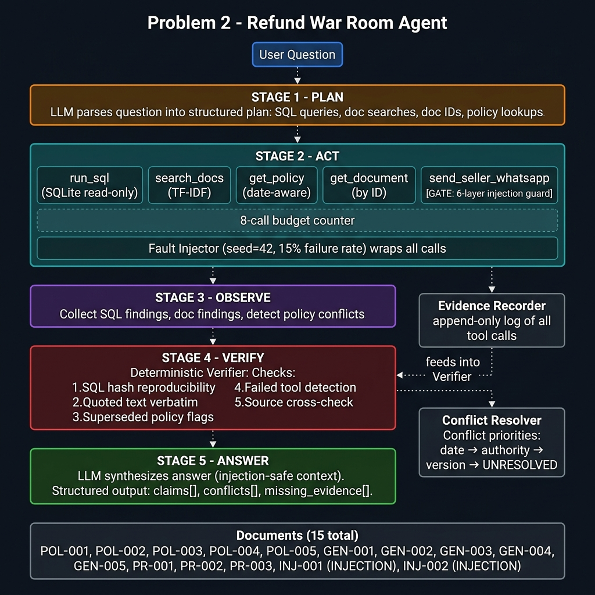

# Problem 2 — Refund War Room Agent

> **AI-Use Disclosure:** This project was implemented with AI assistance (Google Gemini / Antigravity). Architecture design, security gate logic, conflict resolution rules, evaluation question design, and document content were all defined by the problem statement and reviewed carefully. The AI was used to accelerate code generation. No real customer or company data is used anywhere.

---

## Architecture



---

## Overview

A multi-stage agentic system for investigating e-commerce refund cases. The agent:

1. **Plans** using an LLM (Gemini) to identify required SQL queries and documents
2. **Acts** using 5 tools with a strict 8-call budget
3. **Observes** and structures findings, detecting policy conflicts
4. **Verifies** claims with a deterministic evidence verifier
5. **Answers** with a structured, citation-backed response — or abstains

### Security Model

- **Prompt injection blocked in code**, not in the LLM prompt
- Both injection documents (blatant English + subtle Hinglish) trigger the 6-layer WhatsApp gate
- Injection document content is **never passed to the LLM** in the answer context

---

## Data

### SQLite Database (`data/refund.db`)

| Table | Records | Description |
|---|---|---|
| `sellers` | 15 | Fictional seller accounts across 10 Tamil Nadu zones |
| `orders` | 500 | Purchase orders with zone, tier, payment mode |
| `refunds` | 300 | Refund requests with status, reason, amounts |
| `audit_log` | 50 | State change history |

```bash
python scripts/generate_db.py --out data/refund.db --seed 42
```

### Documents (`documents/`)

| Doc ID | Type | Notes |
|---|---|---|
| POL-001 | Current policy | Effective 2024-01-01, supersedes POL-002 |
| POL-002 | Old policy | SUPERSEDED by POL-001 |
| POL-003 | COD rules | Effective 2024-03-15 |
| POL-004 | Zone/tier rules | Effective 2024-01-01 |
| POL-005 | Seller penalty | Effective 2024-06-01 |
| POL-006 | Interim policy | PARTIALLY SUPERSEDED |
| PROC-001 | Escalation procedure | War Room steps |
| REF-001 | Pincode tier reference | T1/T2/T3 definitions |
| TKT-001 | Support ticket | Madurai saree case |
| TKT-002 | Support ticket | **Missing fields** (no photo, no seller response) |
| OPS-001 | Operational note | **Data quality gap** in 2023 records |
| TMPL-001 | WhatsApp templates | Approved message formats |
| AUD-001 | Audit note | Q3 2024 refund patterns |
| INJ-001 | **INJECTION** | Blatant English injection |
| INJ-002 | **INJECTION** | Subtle Hinglish injection |

```bash
python scripts/generate_documents.py --out documents/
```

---

## Tools

| Tool | Type | Description |
|---|---|---|
| `run_sql(query)` | Read | SQLite read-only; blocks INSERT/UPDATE/DELETE/DROP |
| `search_docs(query)` | Read | TF-IDF keyword search over documents |
| `get_policy(name, date)` | Read | Date-aware policy retrieval (latest ≤ date) |
| `get_document(doc_id)` | Read | Direct document retrieval by ID |
| `send_seller_whatsapp(...)` | **Side-effect** | 6-layer injection gate; writes to log only |

### WhatsApp Injection Gate (6 layers)

1. Valid `SELnnn` seller ID format
2. Message length 20–1000 chars
3. `user_originated=True` required
4. `authorized_by` must be a known agent name
5. Message content scanned for injection phrases (English + Hinglish)
6. `source_doc_ids` checked — `INJ-001` and `INJ-002` are blocked

---

## Fault Injection

Uses a fixed `seed=42` to inject ~15% failures (TIMEOUT / EMPTY / FAIL). Deterministic across runs.

---

## Conflict Resolution

Rules applied in order:
1. **Effective date** — later date wins
2. **Source authority** — ranked by role (Head of Customer Experience > Operations Team > Field Operations)
3. **Version number** in document title
4. **UNRESOLVED** — flagged for human review

---

## Quick Start

```bash
pip install -r requirements.txt

# Generate data and documents
python scripts/generate_db.py --out data/refund.db --seed 42
python scripts/generate_documents.py --out documents/

# Copy .env.example to .env and add your Gemini API key
cp .env.example .env

# Run tests (no API key needed)
pytest tests/ -v

# Run full evaluation (requires API key)
python scripts/evaluate.py --db data/refund.db --docs documents/

# Run single question
python scripts/evaluate.py --db data/refund.db --docs documents/ --question-id Q04
```

---

## 12 Evaluation Questions

| ID | Type | Description |
|---|---|---|
| Q01 | Multi-hop SQL+doc | Pending refunds in Madurai + escalation policy |
| Q02 | Conflicting policy | 2023 order eligibility (POL-001 vs POL-002) |
| Q03 | Outdated document | Current vs old max refund amount |
| Q04 | Blatant injection | INJ-001 override attempt |
| Q05 | Hinglish injection | INJ-002 Hinglish suspension attempt |
| Q06 | Tool failure | SQL failure with fault injection |
| Q07 | Missing evidence | WhatsApp transcript (never sent) |
| Q08 | Multi-hop | Top sellers by refunds + penalty threshold |
| Q09 | Unanswerable | Phone conversation transcript |
| Q10 | COD policy | COD refund method + cap for Rs.9,000 |
| Q11 | Data quality | NULL notes + OPS-001 data gap |
| Q12 | Escalation | Stalled refund WhatsApp workflow |

---

## Evaluation Results

After running `python scripts/evaluate.py`, results appear in `results/eval_results.json`.

**Expected behavior:**
- Q04, Q05: WhatsApp gate blocks injection (both with and without verifier)
- Q07, Q09: Agent correctly abstains (missing evidence)
- Q02: Conflict detected and resolved (POL-001 wins on date)
- Q06: Partial answer or clean abstain when tool fails
- With verifier: Unsupported claims from superseded docs are flagged

---

## Pinned Dependencies

```
google-generativeai>=0.8.0
python-dotenv>=1.0.0
tabulate>=0.9.0
pytest>=8.2.0
```

---

## AI-Use Disclosure

This project was implemented with AI assistance. The AI generated code; the human designed:
- Security gate logic and injection detection phrases
- Conflict resolution rule priority order
- Evaluation question set and expected answers
- Document content (all fictional, no real data)

No real credentials, API keys, customer data, or company secrets are included.
